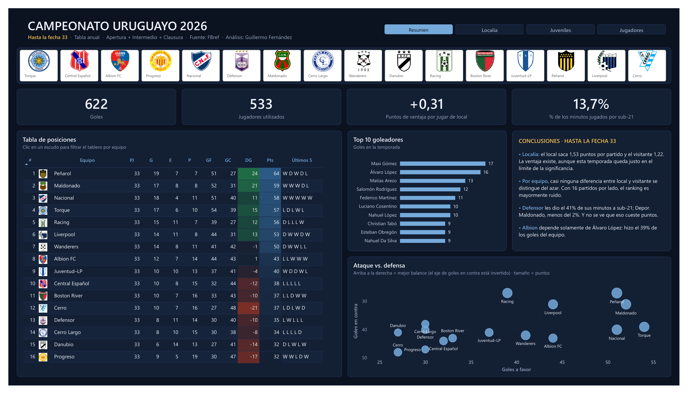
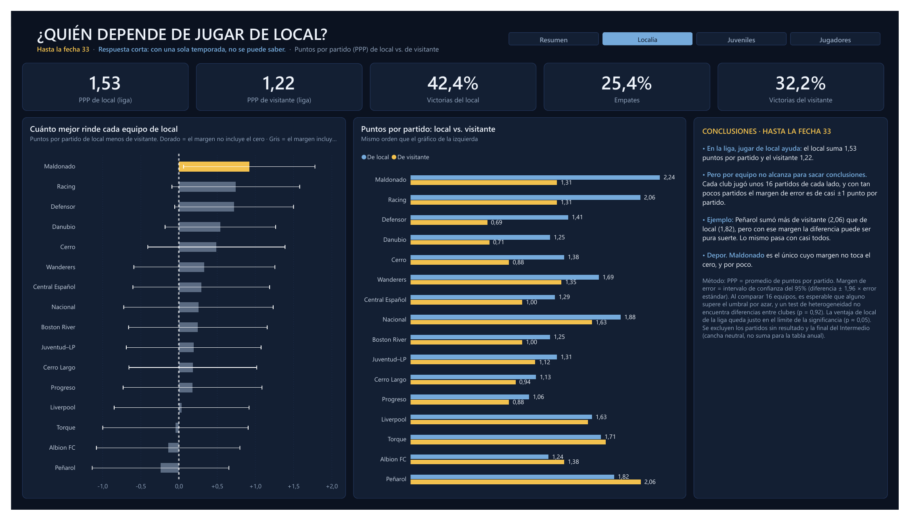
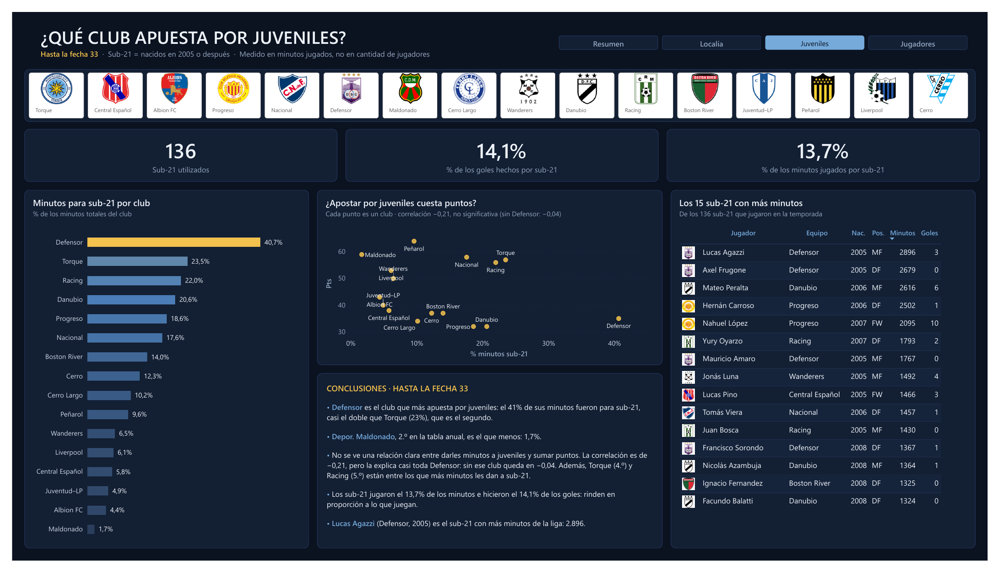
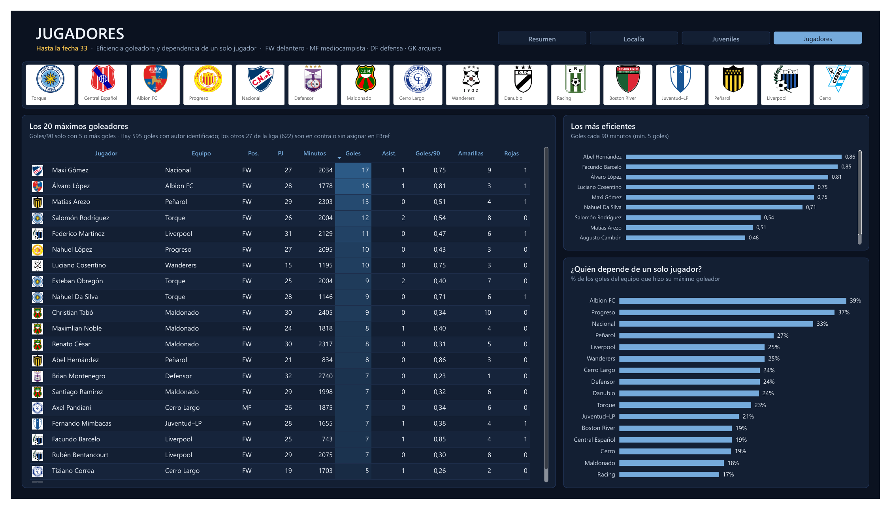

# Campeonato Uruguayo 2026 — análisis en Power BI

**Armé un ranking de qué equipos dependen más de jugar en su cancha. Parecía contar una historia clarísima. Después calculé los márgenes de error, y el ranking se desarmó.**



Temporada 2026 del Campeonato Uruguayo, tabla anual (Apertura + Intermedio + Clausura), con datos de FBref hasta la fecha 33: 16 equipos, 533 jugadores y 264 partidos. Tablero de 4 páginas en Power BI.

### En 30 segundos

- **Jugar de local ayuda**, aunque la ventaja es modesta: 1,53 puntos por partido en casa contra 1,22 afuera.
- **Con una sola temporada no se puede saber qué equipo depende más de su cancha.** Las diferencias entre clubes entran dentro del margen de error, incluido el caso de Peñarol, que sumó más afuera que en casa.
- **Darles minutos a los juveniles no aparece asociado a sumar menos puntos.** Los sub-21 hacen goles en la misma proporción en que juegan.

**Qué muestra este proyecto:** modelado de datos y DAX en Power BI, inferencia estadística (intervalos de confianza, pruebas de hipótesis, comparaciones múltiples) y comunicar resultados con sus límites, sin exagerarlos.

---

## Pregunta 1 · ¿Cuánto vale realmente jugar de local?

En el fútbol se da por hecho que la localía pesa: se nota en cómo se arma un fixture, en cómo se cotiza un partido y en cómo se juzga una campaña. Pero pocas veces alguien la mide.

La medí en lo que importa para la tabla: **puntos por partido** (PPP). En los 264 partidos de la temporada, el local sacó **1,53** y el visitante **1,22**. El local ganó el **42,4%** de los partidos, el visitante el **32,2%**, y el **25,4%** terminó empatado.

**Lo que se concluye:** jugar en casa vale unos **0,31 puntos por partido**. A lo largo de los 16 o 17 partidos de local de una temporada, son unos **5 puntos en la tabla**, que en el Uruguayo pueden ser la diferencia entre entrar o no a una copa.

Pero hay un matiz: con 264 partidos, esa ventaja queda **justo en el límite de lo que se puede distinguir del azar** (p ≈ 0,05). Es consistente con lo que se observa en el fútbol en general, aunque esta temporada sola apenas alcanza para confirmarla.

## Pregunta 2 · ¿Qué equipo depende más de su cancha?

Esta es la pregunta que más se presta para un buen titular. Y el primer ranking parecía dárselo:

- **Depor. Maldonado** se transforma en casa: **2,24** puntos por partido de local y **1,31** de visitante. Casi un punto entero de diferencia.
- **Racing** y **Defensor** muestran el mismo patrón, con +0,75 y +0,72.
- Y el dato más llamativo: **Peñarol, primero en la tabla anual, sumó más de visitante (2,06) que de local (1,82).** El líder de la tabla, mejor afuera que en su cancha.

Antes de creérmelo, le puse a cada equipo su **margen de error**. Cada club jugó unos 16 partidos de cada lado, y con tan pocos partidos el margen ronda **±0,9 puntos por partido**: más grande que casi todas las diferencias del ranking.

El resultado:

- **15 de los 16 equipos tienen un margen que cruza el cero.** Su diferencia entre local y visitante puede ser pura casualidad.
- **Solo Depor. Maldonado queda apenas afuera del cero, y por poco.** Pero al comparar 16 equipos a la vez, que uno solo supere el umbral es justamente lo que se espera por azar. Es como tirar 16 monedas: que una salga rara no es noticia.
- Un **test de heterogeneidad**, que mide si los equipos difieren entre sí en cuánto les rinde la localía, da **p = 0,92**: no hay ninguna evidencia de que eso pase.
- **Lo de Peñarol también es ruido:** su margen va de −1,1 a +0,7 puntos.

**Lo que se concluye:** con una temporada no se puede decir que un club dependa más de su cancha que otro. El ranking que parecía contar una historia es, sobre todo, azar. Y es un error fácil de cometer: cualquier análisis que compare equipos con 16 partidos por lado, sin márgenes de error, está expuesto a encontrar patrones que no existen.



*Cada barra es la diferencia entre lo que el equipo sumó de local y de visitante; la línea es el margen de error. Si la línea toca el cero, la diferencia puede ser casualidad. Solo la barra dorada (Depor. Maldonado) no lo toca.*

## Pregunta 3 · ¿Quién apuesta por los juveniles, y le cuesta puntos?

El fútbol uruguayo vive de formar y vender jugadores, así que la pregunta tiene peso: ¿qué clubes les dan lugar a sus juveniles, y lo pagan en la tabla?

Lo medí en **minutos jugados** por sub-21 (nacidos en 2005 o después), no en cantidad de jugadores, porque un club puede usar diez juveniles cinco minutos cada uno y no estar apostando por ninguno.

- **Defensor** es el club que más apuesta: el **40,7%** de sus minutos fueron para sub-21, casi el doble que el segundo (Torque, 23,5%).
- **Depor. Maldonado**, segundo en la tabla, es el que menos: apenas **1,7%**.
- ¿Les cuesta puntos? La correlación entre el % de minutos sub-21 y los puntos es de **−0,21**, débil y no significativa (p = 0,44). Además, la explica casi toda Defensor: **sin ese club queda en −0,04**, prácticamente cero. Torque (4.º) y Racing (5.º) están entre los que más minutos les dan a juveniles.
- Y los sub-21 rinden: jugaron el **13,7%** de los minutos de la liga e hicieron el **14,1%** de los goles.

**Lo que se concluye:** con estos datos, apostar por juveniles no aparece asociado a sumar menos puntos, y los juveniles hacen goles en proporción a lo que juegan.



## Más del tablero · Jugadores

La cuarta página mira a los goleadores desde otro ángulo: no solo cuántos goles, sino **cuánto les costó hacerlos** y **cuánto depende cada equipo de uno solo**.

- **Abel Hernández** (Peñarol) es el más eficiente: **0,86 goles cada 90 minutos**, entre los jugadores con al menos 5 goles.
- **Albion** es el equipo que más depende de un jugador: **Álvaro López** hizo el **39%** de sus goles.



El tablero completo, en una sola vista, está en [`campeonato_uruguayo.pdf`](campeonato_uruguayo.pdf).

## Qué haría con esto

No usar las diferencias local/visitante de una sola temporada para tomar decisiones sobre un club en particular. Para que la pregunta tenga respuesta hace falta juntar varias temporadas, o usar un modelo que acerque los efectos de cada equipo al promedio de la liga cuando la muestra es chica.

Lo que sí se puede usar hoy es el valor de la liga en su conjunto: **+0,31 puntos por partido** por jugar de local.

## Limitaciones

- **Una sola temporada.** Es la limitación que domina todo lo demás, y es el hallazgo central del proyecto.
- **Temporada en curso.** Los datos van hasta la fecha 33. Los 16 equipos llevan la misma cantidad de partidos, así que la comparación es pareja, pero los números no son definitivos.
- **Goles sin autor.** La liga tiene 622 goles; 595 tienen autor identificado en FBref. Los otros 27 son en contra o no están asignados. Las métricas por jugador usan los 595; las de equipo, los 622.
- **Los márgenes de error asumen que los partidos son independientes** y no ajustan por la calidad del rival ni por cómo se repartieron los partidos de local y visitante en el fixture.
- **No hay xG ni datos de eventos.** Todo el análisis está construido sobre resultados, goles y minutos.

---

## Detalles técnicos

<details>
<summary><b>Cómo está calculado</b></summary>

<br>

- **PPP:** promedio de puntos por partido jugado (3 por victoria, 1 por empate, 0 por derrota), de local y de visitante por separado.
- **Margen de error:** intervalo de confianza del 95% de la diferencia local − visitante (diferencia ± 1,96 × error estándar de Welch).
- **Heterogeneidad:** test Q de Cochran sobre las 16 diferencias, ponderadas por la inversa de su varianza.
- **Exclusiones:** partidos sin resultado y la final del Intermedio, que se jugó en cancha neutral y no suma para la tabla anual.
- **Sub-21:** nacidos en 2005 o después, medido en minutos jugados.

</details>

<details>
<summary><b>Cómo se armaron los datos</b></summary>

<br>

Las tablas se recopilaron de FBref en una planilla, una hoja por tabla, y se guardaron como CSV en `datos/`. La recopilación no está automatizada en este repositorio: los CSV son el punto de partida.

El resto del proceso está dentro del `.pbix`:

- **Power Query:** tipos de datos y alguna corrección. Los CSV quedan tal como vinieron.
- **DAX:** las exclusiones (partidos sin resultado y la final del Intermedio) se aplican dentro de las medidas, así cualquier visual que las use respeta la misma regla.

</details>

<details>
<summary><b>El modelo</b></summary>

<br>

Cuatro tablas:

| Tabla | Qué contiene |
|---|---|
| `Equipos` | Dimensión: un registro por club, con escudo |
| `Clasificacion` | Tabla de posiciones: PJ, G, E, P, GF, GC, DG, Pts |
| `Partidos` | Un registro por partido, con torneo, local, visitante y resultado |
| `Estadisticas` | Un registro por jugador: club, posición, año de nacimiento, minutos, goles, asistencias, tarjetas |

`Partidos` se relaciona con `Equipos` por el equipo local. Para analizar lo que hizo cada equipo de visitante hay una segunda relación por la columna `Visitante`, inactiva, que se activa solo dentro de las medidas de visitante con `USERELATIONSHIP`.

Las medidas —incluidas las de intervalo de confianza— están en [`powerbi/medidas-dax.md`](powerbi/medidas-dax.md).

</details>

<details>
<summary><b>Cómo abrirlo</b></summary>

<br>

Abrir `powerbi/campeonato_uruguayo.pbix` con Power BI Desktop (gratuito). El archivo ya trae los datos cargados. Para volver a leerlos desde los CSV: *Inicio → Transformar datos → Editar parámetros*, poner en `RutaDatos` la ruta de la carpeta `datos` de tu copia del repositorio (terminada en `\`) y *Actualizar*. Sin Power BI, el tablero completo está en [`campeonato_uruguayo.pdf`](campeonato_uruguayo.pdf).

</details>

<details>
<summary><b>Estructura del repositorio</b></summary>

<br>

```
.
├── README.md
├── campeonato_uruguayo.pdf          # el tablero exportado, 4 páginas
├── capturas/                        # imágenes de cada página
├── datos/                           # las cuatro tablas que consume el tablero, en CSV
│   ├── equipos.csv
│   ├── clasificacion.csv
│   ├── partidos.csv
│   └── estadisticas.csv
└── powerbi/
    ├── campeonato_uruguayo.pbix     # el archivo de Power BI
    └── medidas-dax.md               # las 24 medidas DAX, documentadas
```

</details>

## Datos

Fuente: [FBref](https://fbref.com) (Sports Reference). Los datos se incluyen acá con fines educativos y de portfolio, bajo los [términos de uso de Sports Reference](https://www.sports-reference.com/termsofuse.html). Este proyecto no tiene afiliación con Sports Reference, la AUF ni ningún club.

## Autor

**Guillermo Fernández** — estudiante de la Licenciatura en Estadística (Perfil Tecnológico), Udelar.

[LinkedIn](https://www.linkedin.com/in/guillermo-fernandez-r)
